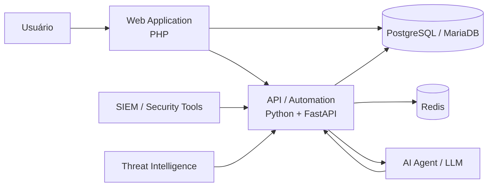

# 👋 Olá, meu nome é Daniel Alves!

### Cybersecurity • GRC • DevSecOps • SaaS • Automation 

Sou profissional de **Tecnologia da Informação e Cibersegurança**, com mais de uma década de experiência em infraestrutura e suporte técnico, além de conhecimentos em segurança da informação, desenvolvimento de soluções e automação.

Possuo graduação em **Análise e Desenvolvimento de Sistemas** e **MBA em Gestão da Cibersegurança Empresarial**, combinando experiência operacional com uma visão crescente de **Governança, Riscos, Compliance e Segurança Cibernética aplicada ao negócio**.

Atualmente concentro meus estudos e projetos em:

- 🛡️ **Cybersecurity & Cyber Risk**
- 📊 **GRC — Governance, Risk & Compliance**
- 🧠 **Inteligência Artificial aplicada à Cibersegurança**
- 🤖 **AI Agents e automação de operações**
- 🔐 **DevSecOps, Zero Trust e Security by Design**
- 🏭 **OT / XIoT Cybersecurity**
- ☁️ **Arquiteturas SaaS e APIs**
- 🐧 **Linux, containers e infraestrutura open source**

> **Transformando riscos cibernéticos em decisões estratégicas.**

---

## 🚀 Áreas de atuação

```text
Cybersecurity
├── GRC & Cyber Risk
├── Security Operations
│   ├── SIEM
│   ├── SOAR
│   ├── CTI
│   └── Incident Response
├── DevSecOps
├── Infrastructure Security
├── OT / XIoT Security
├── AI for Cybersecurity
└── Security Automation
```

Também desenvolvo projetos voltados à criação de **MVPs, plataformas SaaS e soluções empresariais**, utilizando principalmente arquiteturas modulares, APIs REST, containers e integração entre sistemas.

---

# 🧠 Tech Stack

## 💻 Desenvolvimento


---

## 🗄️ Dados


---

## 🐧 Infraestrutura & DevOps


---

## 🔐 Cybersecurity


### Frameworks & Governança


---

## 🤖 Inteligência Artificial & Automação


Tenho especial interesse na aplicação de **LLMs, RAG e agentes de IA em operações de segurança**, incluindo análise de alertas, enriquecimento de Threat Intelligence, automação de resposta e apoio à tomada de decisão.

---

# 🛡️ Projetos em destaque

## 🐺 WOLF Cyber Security

Ecossistema de soluções voltadas à **Governança, Operações de Segurança, Cyber Risk e automação**.

---

## WOLF GRC

Plataforma para entrega de:

- GRC as a Service
- Cyber Risk Management
- vCISO
- Gestão de controles
- Gestão de evidências
- Risk Register
- Compliance
- Indicadores executivos
- Integração com SIEM, ITSM e agentes de IA

### Stack principal

```text
PHP / Python
PostgreSQL / MariaDB
Redis
Docker
REST APIs
Ollama
AI Agents
```

---

## WOLF UCP

Plataforma voltada à consolidação de dados provenientes de diferentes componentes da operação de segurança.

```text
SIEM
SOAR
CTI
Firewall
IDS/IPS
Monitoring
ITSM
OT Security
```

Objetivo:

> Transformar telemetria técnica em contexto operacional e informação útil para tomada de decisão.

---

## WOLF Cyber Agent

Agente de IA especializado em **Cybersecurity Reasoning**.

Integrações projetadas com:

- Wazuh
- pfSense
- Suricata
- WOLF CTI
- WOLF GRC
- WOLF OT Sentinel
- Zabbix
- ITSM
- Threat Intelligence

Arquitetura baseada em:

```text
FastAPI
Python
RAG
Ollama
Local LLM
REST APIs
WJP
```

---

## WOLF CTI

Plataforma de **Cyber Threat Intelligence e OSINT** para agregação, enriquecimento e análise de indicadores de comprometimento.

Integrações incluem fontes como:

```text
AlienVault OTX
NVD
CISA KEV
ThreatFox
URLhaus
EPSS
CVSS
MITRE ATT&CK
```

---

## OT Sentinel

Plataforma voltada ao monitoramento e gestão de riscos em ambientes:

- OT
- ICS
- IIoT
- XIoT
- Infraestruturas críticas

Com foco em:

```text
Asset Discovery
Risk Scoring
Vulnerability Management
Network Monitoring
Threat Detection
Operational Resilience
```

---

# 🏗️ Arquitetura que costumo utilizar



Princípios que busco aplicar nos projetos:

- Clean Architecture
- Security by Design
- Privacy by Design
- Zero Trust
- Least Privilege
- DevSecOps
- API First
- Containerização
- Observabilidade
- Automação
- Integrações desacopladas

---

# 🎯 Cybersecurity & GRC

Tenho interesse especial na convergência entre:

```text
Tecnologia
     +
Cybersecurity
     +
Gestão de Riscos
     +
Governança
     +
Automação
     +
Inteligência Artificial
```

Meu objetivo é desenvolver soluções capazes de traduzir informações técnicas como:

```text
CVEs
Alertas
Logs
IOCs
Incidentes
Vulnerabilidades
Falhas de configuração
```

em informações relevantes para o negócio:

```text
Risco
Impacto
Probabilidade
Prioridade
Compliance
Continuidade
Decisão executiva
```

---

# 📚 Certificações & Conhecimentos

Áreas de estudo e certificação incluem:

- ISO/IEC 27001
- COBIT 2019
- ITIL 4
- Microsoft Security
- Cyber Threat Intelligence
- OSINT
- Linux
- Python
- Gestão de Riscos
- Segurança da Informação
- Infraestrutura
- DevSecOps

---

# 🔬 Atualmente pesquisando

```text
AI Agents for Cybersecurity
Cybersecurity Reasoning
Local LLMs
RAG
Agentic Security Operations
AI Governance
Cyber Risk Quantification
GRC Automation
Security Orchestration
OT / XIoT Security
Post-Quantum Cryptography
```

---

# 🧪 Filosofia de laboratório

Grande parte dos meus projetos nasce da combinação:

```text
Problema real
    ↓
Pesquisa
    ↓
Arquitetura
    ↓
MVP
    ↓
Automação
    ↓
Security by Design
    ↓
Produto
```

Sempre que possível, utilizo tecnologias **open source**, ambientes Linux, containers e automação para construir soluções reproduzíveis e economicamente viáveis.

---

# 📈 GitHub Stats

<div align="center">


</div>

---

<div align="center">

### 🐺 Cybersecurity • GRC • AI • Automation

**Building secure systems. Automating operations. Transforming cyber risk into strategic decisions.**

</div>
